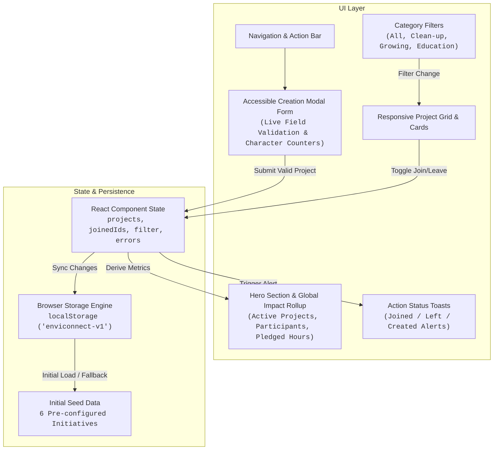

# EnviConnect

[](https://github.com/akvikas/enviconnect/actions/workflows/ci.yml)
[](https://react.dev/)
[](https://www.typescriptlang.org/)
[](https://vitest.dev/)
[](https://opensource.org/licenses/MIT)

A responsive community action platform designed to discover, pledge, and organize local sustainability initiatives. Built with React 19, TypeScript, Tailwind CSS v4, and Vitest.

> [!NOTE]
> **Data Persistence Architecture:** EnviConnect uses browser-local storage (`localStorage` under `enviconnect-v1`) with zero cold-start delay and no external database. Data is private to your browser session and does not synchronize across separate devices.

---

## What It Does

- **Initiative Discovery & Category Filtering:** Browse community projects across clean-up drives, urban farming/gardening, and climate education with zero latency.
- **Dynamic Participation & Pledging:** Join or leave initiatives with a single click. Aggregate participant counts and total pledged volunteer hours update instantaneously.
- **Strictly Validated Project Creation:** Modal form enforcing title length (3–80 chars), description depth (10–500 chars), category classification, and realistic volunteer commitments (1–40 hours). Project creators are automatically joined as the initial organizer.
- **Resilient UI States:** Handles loading skeletons, empty filtered categories with one-click resets, empty database recovery, and animated toast feedback for user actions.
- **Sample Data & Reset Control:** Pre-seeds realistic community initiatives on first visit, with a one-click reset action to restore default state at any time.

---

## Architecture & Data Flow



---

## Quickstart & Local Setup

### Prerequisites
- **Node.js:** 20.x or 22.x LTS
- **npm:** 10.x+

### Run Locally

```bash
# 1. Clone repository
git clone https://github.com/akvikas/enviconnect.git
cd enviconnect

# 2. Install dependencies
npm install

# 3. Start local development server
npm run dev
```

The application will be available at `http://localhost:5173`.

### Quality & Build Commands

```bash
# Run unit and component test suite
npm test

# Run TypeScript compiler check
npm run typecheck

# Build optimized production bundle
npm run build
```

---

## Testing & Quality Assurance

EnviConnect is tested using **Vitest** and **React Testing Library** in a simulated DOM environment (`jsdom`).

```bash
npm test
```

### Verified Test Cases:
1. **Initial Hydration:** Verifies header, hero impact metrics, and seed projects render correctly from storage.
2. **Category Filtering:** Validates filtering by `"cleanup"`, `"growing"`, and restoring via `"all"`.
3. **Pledging Mechanics:** Verifies join/leave state transitions, participant count increments/decrements, button label toggles, and toast alerts.
4. **Form Validation Guardrails:** Ensures empty submissions trigger specific field error alerts for title, description, category, and hours.
5. **Project Creation:** Confirms that submitting valid form data injects a new initiative card into the UI, pledges the creator, and closes the modal.
6. **Empty State Recovery:** Tests graceful rendering when no projects match the filter or storage is cleared, with working reset buttons.

---

## Form Validation Rules

| Field | Validation Rule | Error Message |
|---|---|---|
| **Title** | 3 to 80 characters, trimmed | *"Project title must be at least 3 characters."* |
| **Description** | 10 to 500 characters, trimmed | *"Description must be at least 10 characters."* |
| **Category** | Required (`cleanup`, `growing`, `education`) | *"Please select a category."* |
| **Hours** | Integer between 1 and 40 | *"Enter a whole number between 1 and 40 hours."* |
| **Location** | Optional, maximum 100 characters | Inline counter prevention |

---

## Continuous Integration (CI)

A GitHub Actions workflow (`.github/workflows/ci.yml`) validates every push and pull request across Node.js versions:
- `npm ci` clean install
- `npm run typecheck` (strict TypeScript validation)
- `npm test` (Vitest component test suite)
- `npm run build` (production Vite SSR and client bundle verification)

---

## Engineering Trade-offs & Limitations

1. **Client-Side Storage vs. Distributed Backend:**  
   Using `localStorage` provides instant zero-latency responses with zero infrastructure cost, ideal for a prototype or client-focused demonstration. In a production multi-user platform, this would be replaced with a REST/GraphQL API connected to PostgreSQL or MongoDB with authentication.
2. **Synchronous State vs. WebSockets:**  
   Participation metrics are currently computed dynamically in-memory from local project states. Multi-user real-time synchronization would require WebSockets or Server-Sent Events (SSE).

---

## Author

**Vikas AK**  
- Portfolio: [akvikas.github.io/3d-portfolio](https://akvikas.github.io/3d-portfolio)  
- GitHub: [@akvikas](https://github.com/akvikas)  
- LinkedIn: [ak-vikas](https://www.linkedin.com/in/ak-vikas-346446291/)  

Distributed under the [MIT License](LICENSE).
